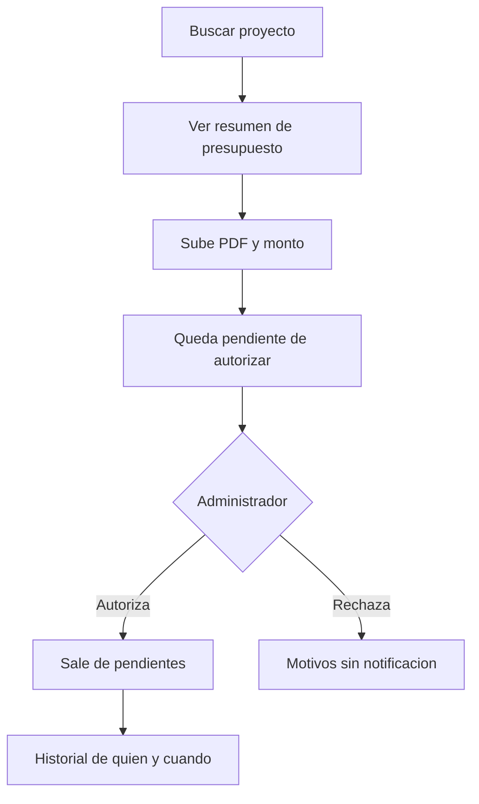
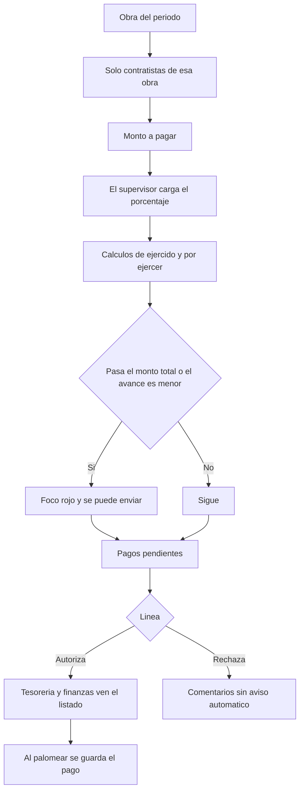
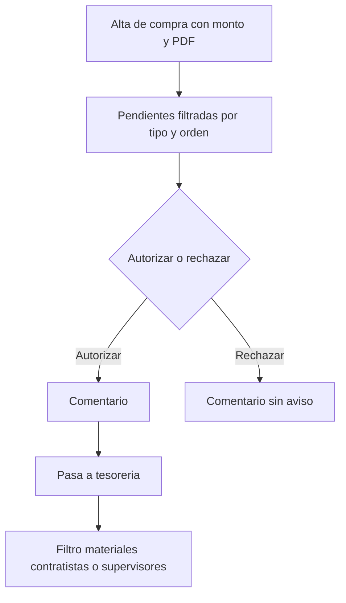
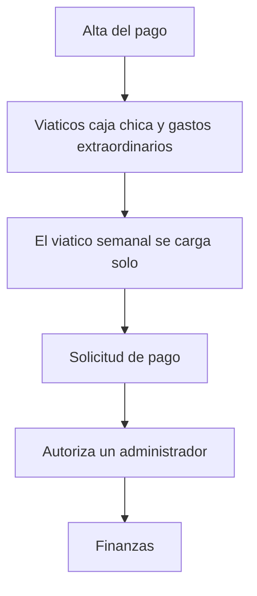
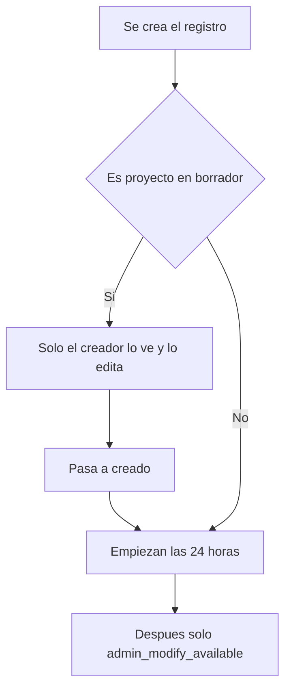
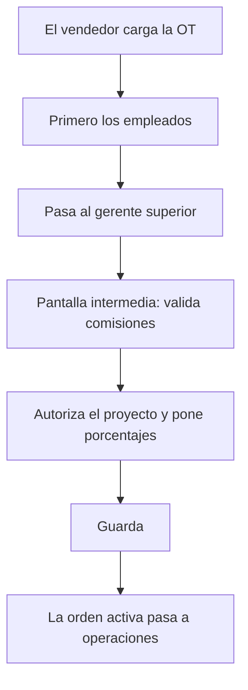
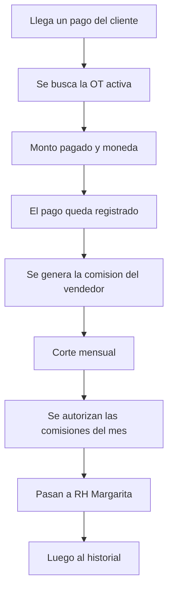

# Documento Funcional

**Proyecto:** Teletec Administración de Obras en proceso  
**Cliente:** Corporativo Teletec  
**Versión:** 1.3

## Índice

1. [Resumen del proyecto](#1-resumen-del-proyecto)
2. [Introducción](#2-introducción)
3. [Objetivo del proyecto](#3-objetivo-del-proyecto)
4. [Funcionamiento por módulo](#4-funcionamiento-por-módulo)
5. [Requisitos de alto nivel](#5-requisitos-de-alto-nivel)
6. [Límites del proyecto](#6-límites-del-proyecto)
8. [Resumen del cronograma de hitos](#8-resumen-del-cronograma-de-hitos)
9. [Ejemplos de flujos con diagramas](#9-ejemplos-de-flujos-con-diagramas)
10. [Reportes](#10-reportes)
11. [Entregables clave](#11-entregables-clave)

## 1. Resumen del proyecto

| Campo | Valor |
|-------|-------|
| Nombre del proyecto | Teletec Administración de Obras |
| Cliente | Corporativo Teletec |
| Versión del documento | 1.3 |
| Primer trabajo | Definir y construir los catálogos, empezando por usuarios y luego el catálogo de área |

## 2. Introducción

Cliente: Corporativo Teletec, https://www.teletec.com.mx/. Fundado en 1971, con capital 100% mexicano. Es líder nacional en equipamiento especializado para espacios culturales y de entretenimiento, y para estaciones de TV. Tiene proyectos en Colombia, Panamá, Venezuela, Bolivia, Perú y Brasil. Combina distribución directa de fábrica con diseño y fabricación nacional.

Teletec Administración de Obras administra clientes, usuarios y proyectos desarrollados. Controla bolsas: Suministros, Materiales de instalación, Acero, Renta de maquinaria, Contratistas, Supervisores, Transporte y la bolsa de la orden. Los administradores autorizan los pagos. Finanzas paga a proveedores y las compras. Rh paga las comisiones de los vendedores. Credito y cobranzas registra los pagos que realizan los clientes. El sistema también cubre personal y comisiones.

Las notas parten del sistema actual de obras en proceso: catálogos, orden de trabajo, cotización, contratistas, avance y pagos. La cotización no está en esta versión. 

## 3. Objetivo del proyecto

- Administrar clientes, usuarios y proyectos (ordenes de trabajo).
- Empezar por los catálogos, en este orden: usuarios, área, clientes, especialidad, supervisores, contratistas, razones sociales, tipo de instalación y proyectos (orden de trabajo). Área, gerencia y tipo de usuario son el mismo catálogo.
- Dar de alta la orden de trabajo, con cliente. El número de SAP se captura a mano. No hay integración con SAP en esta versión.
- Las bolsas a controlar: Suministros, Materiales de instalación, Acero (monto en $ y en Kg), Renta de maquinaria, Contratistas, Supervisores, Transporte y la bolsa de la orden, que es cuánto se le vendió al cliente. Bolsas y montos son el mismo concepto. Impuestos no entran.
- Los administradores autorizan los pagos del sistema, incluidos los presupuestos que capturan los vendedores.
- Finanzas paga proveedores y compras.
- Cubrir personal, que es el catálogo de usuarios, y comisiones. Al cargar la orden, el vendedor carga todo. El gerente superior autoriza el proyecto y pone los porcentajes. La comisión externa queda con las dos frases que escribió Victoria: «10-15%» y «1 monto fijo». No se elige entre ellas.
- Cotización: **pendiente con el cliente**. Falta que definan cliente, gastos de supervisión y tipos de cambio.
- Pagar a los contratistas cada semana, con avance, cálculos y focos rojos. Un pago con foco rojo se puede enviar.
- Autorizar esos pagos, línea por línea, y pasarlos a tesorería y finanzas.
- Dar de alta y autorizar pagos a supervisores y pagos de compras. El viático semanal es un monto por supervisor, se carga solo y lo autoriza un administrador.
- El supervisor entra al sistema: levanta órdenes de compra de materiales, registra pagos a contratistas y carga el avance físico, que es un porcentaje.
- El usuario es el correo. El alta es una invitación por correo. Un inactivo no entra.

## 4. Funcionamiento por módulo

El primer trabajo es definir y construir los catálogos.

Orden para empezar:

1. Usuarios. En la nota: Usuarios Personal.
2. Área. Es el mismo catálogo que gerencia y que tipo de usuario.
3. Clientes.
4. Especialidad.
5. Supervisores.
6. Contratistas.
7. Razones sociales.
8. Tipo de instalación.
9. Proyectos. En la nota: orden de trabajo.

Especialidad y tipo de instalación son dos catálogos.

Roles y permisos no es otro catálogo. Crece cuando se agregan funciones. Los permisos son por área y por usuario, no por empresa. Un usuario puede tener varios roles. Los actores son los roles asignados al usuario.

Dos roles dan de alta los catálogos y asignan permisos: superadmin, que corresponde a desarrolladores, y admin, que corresponde a administrativos. David es un ejemplo de admin, no un usuario fijo.

Crédito y cobranza es un rol. Cuando llega un pago del cliente, busca la OT activa, captura el monto pagado y la moneda, y el pago queda registrado. Cargar ese pago genera la comisión del vendedor por pagar. Admin ve, por cliente, saldo total, saldo pagado, cuánto falta por pagar, y qué clientes pagaron a tiempo.

Las claves de visibilidad de proyectos ya nombradas son:

- `projects_mine`: solo los proyectos propios. Un vendedor ve solo sus órdenes de trabajo, no las de un compañero.
- `projects_all`: todos los proyectos. El gerente de operaciones ve todas las obras.
- `projects_group`: el supervisor designado en el proyecto. Ve solo los proyectos en los que está asignado. Esa persona puede ser el vendedor o el instalador. Si no tiene obras asignadas, igual puede entrar y no ve nada.

Cada módulo dice quién lo usa, qué hace el sistema, qué datos toca, qué reglas aplican y el flujo.

### 4.1 Usuarios

Catálogo 1. En la nota se llama Usuarios Personal. Personal del sistema es este catálogo.

Descripción: personal de Teletec enfocado a usar el sistema.

**Quién lo usa:** superadmin y admin dan de alta el catálogo y asignan permisos. Los permisos del usuario salen de su área y, cuando hace falta, de ese usuario.

**Qué hace el sistema:** registra, edita, activa y desactiva al usuario. Concede permisos por su área y por su usuario. En el usuario, y en quien tenga correo, ofrece copiar el correo y abrir mailto.

**Datos:**

- Nombre y apellido.
- Correo. El usuario es el correo. El correo es obligatorio.
- Teléfono de WhatsApp.
- Un área. Sale del catálogo de área. Área, gerencia y tipo de usuario son el mismo concepto.
- Activo e inactivo, fecha de creación, fecha de activación y fecha de borrado. El usuario tiene activo e inactivo, y una fecha de borrado, para que el historial se pueda seguir viendo.

**Reglas:**

- Un usuario puede tener varios roles.
- Los permisos son por área y por usuario, no por empresa.
- Los permisos crecen cuando se agregan funciones. No hay una matriz cerrada.
- Crédito y cobranza registra el pago del cliente sobre la OT activa.
- El usuario es el correo. El correo es obligatorio.
- La contraseña tiene mínimo 8 caracteres, con minúscula y mayúscula. No se agregan números ni símbolos.
- El navegador puede guardar la contraseña.
- El alta es una invitación por correo.
- Hay recuperación de contraseña.
- Un inactivo no puede entrar.
- Copiar y mailto entran en esta versión, en usuarios y en quien tenga correo.

**Flujo:**

1. El alta es una invitación por correo.
2. Se da de alta la persona con nombre y apellido. El usuario es el correo.
3. Se le ubica en un área.
4. Los permisos se otorgan desde su área y, si aplica, a nivel de ese usuario.
5. Si está inactivo, no entra. La fecha de borrado permite seguir viendo el historial.

OTP y un segundo factor no son de esta versión. Quedan para otra fase.

### 4.2 Área, gerencia y tipo de usuario

Catálogo 2. Área, gerencia y tipo de usuario son el mismo catálogo. No se mantienen separados.

Descripción: área encargada del proyecto.

**Quién lo usa:** superadmin y admin lo llenan y asignan sus permisos. En los demás módulos, el uso se define por área y por usuario.

**Qué hace el sistema:** guarda las áreas. Desde cada área se otorgan permisos, y también a un usuario cuando hace falta.

**Datos:**

- Nombre.
- Activo.

**Reglas:**

- Es un solo catálogo.
- Los vendedores se dividen por gerencias.
- superadmin y admin dan de alta los catálogos y asignan permisos.
- David es un ejemplo de admin, no un usuario fijo.
- Los permisos son por área y por usuario, no por empresa.

**Flujo:**

1. superadmin o admin da de alta un área.
2. Desde esa área, y cuando hace falta desde un usuario, se asignan permisos.

**Ejemplos**

- Espectáculos
- Licitaciones
- Servicio TECO
- Interno

### 4.4 Especialidad

Catálogo de especialidad. Es distinto del catálogo de tipo de instalación.

Descripción: en qué es especialista un supervisor. Ejemplo: iluminación, audio, video.

**Quién lo usa:** se define por área y por usuario. superadmin y admin dan de alta el catálogo.

**Qué hace el sistema:** guarda las especialidades que luego se asignan al supervisor.

**Datos:**

- Nombre.

**Reglas:** el supervisor toma la especialidad de este catálogo. Un supervisor puede tener más de una.

**Flujo:**

1. Existe el catálogo de especialidad.
2. Al dar de alta un supervisor se elige una o varias.
3. Si no existe la especialidad, el sistema la crea.

### 4.5 Clientes y contactos

Catálogo de clientes.

Descripción: persona o empresa que contrata los servicios de Teletec para realizar un proyecto u obra. Dentro de la empresa hay varios contactos.

**Quién lo usa:** se define por área y por usuario. superadmin y admin dan de alta el catálogo.

**Qué hace el sistema:** guarda al cliente y a varios contactos, clasificados por tipo. En el contacto, el icono de WhatsApp abre la conversación cuando alguien hace clic. Si el contacto tiene correo, se puede copiar y abrir mailto. El número de SAP se captura a mano.

**Datos:**

- Cliente: nombre, RFC, número de SAP, fecha de registro, activo e inactivo.
- Contacto: nombre, correo, teléfono, teléfono de oficina o extensión, activo e inactivo.
  - Tipos de contacto: compras y operaciones.

**Reglas:**

- Un cliente puede tener varios contactos.
- Los contactos se clasifican por tipo.
- El icono de WhatsApp abre la conversación a mano. No hay envío automático.
- El número de SAP no se integra con SAP en esta versión.

**Flujo:**

1. Se registra el cliente con nombre, número de SAP y RFC.
2. Se agregan uno o más contactos.
3. Cada contacto lleva un tipo.
4. Desde el contacto se abre WhatsApp al hacer clic en el icono.

### 4.6 Supervisores de obra

Catálogo de supervisores.

Descripción: personas, a veces externas, que verifican un proyecto o una obra en proceso.

**Quién lo usa:** se define por área y por usuario. superadmin y admin dan de alta el catálogo.

**Qué hace el sistema:** guarda supervisores, a veces externos, con especialidad de catálogo. Una obra puede tener más de uno. Al dar de alta al supervisor se asigna el viático semanal. Ese monto se carga solo cada semana, y un administrador autoriza esa carga. El supervisor entra al sistema: levanta órdenes de compra de materiales y registra pagos a contratistas. Carga el avance físico, que es un porcentaje.

**Datos:** nombre, especialidad, teléfono de WhatsApp, correo.

**Reglas:**

- Pueden ser externos.
- La especialidad sale del catálogo de especialidad. Un supervisor puede tener más de una.
- Más de un supervisor por obra.
- El viático semanal es un monto por supervisor.
- El icono de WhatsApp abre la conversación a mano. Si hay correo, se puede copiar y abrir mailto.
- `projects_group` aplica cuando un supervisor está designado en el proyecto. Esa persona puede ser el vendedor o el instalador, y ve solo esos proyectos.
- El supervisor entra al sistema. Solo ve las obras que tiene asignadas. Puede entrar aunque no tenga ninguna; en ese caso no ve nada.
- Quien carga el avance físico es el supervisor. El avance físico es un porcentaje.
- Levanta órdenes de compra de materiales y registra pagos a contratistas.
- El alta es la invitación por correo de usuarios.

**Flujo:**

1. Se da de alta el supervisor con sus datos. El alta es una invitación por correo.
2. Se elige una o varias especialidades.
3. Se asigna el monto del viático semanal.
4. Entra al sistema y ve solo las obras asignadas. Si no tiene ninguna, entra y no ve nada.
5. En esas obras levanta órdenes de compra de materiales, registra pagos a contratistas y carga el avance físico.

### 4.7 Contratistas

Catálogo de contratistas.

Descripción: personas externas que se contratan para realizar una obra.

**Quién lo usa:** se define por área y por usuario. superadmin y admin dan de alta el catálogo.

**Qué hace el sistema:** guarda al contratista para poder pagarle y ligarlo a la obra. El número de SAP se captura a mano.

**Datos:** nombre, número de SAP, celular, correo, empresa, contactos.

**Reglas:**

- El número de SAP es un dato capturado a mano. No hay integración con SAP en esta versión.
- El celular se puede copiar, y el icono de WhatsApp abre la conversación a mano.
- Si hay correo, se puede copiar y abrir mailto.

**Flujo:**

1. Se registra el contratista.

**Pendiente con el cliente:** nomenclatura de los números de SAP.

### 4.8 Razones sociales

Catálogo de razones sociales con las que Teletec factura.

Descripción: nombre y registro en el SAT de las empresas, como Teletec.

**Quién lo usa:** se define por área y por usuario. superadmin y admin dan de alta el catálogo.

**Qué hace el sistema:** guarda esas razones sociales. En la orden de trabajo valida la nomenclatura contra el cliente y la razón social.

**Datos:** razón social, activa e inactiva.

**Reglas:** la orden valida la nomenclatura contra el catálogo de cliente y la razón social.

**Flujo:**

1. Existe el catálogo.
2. Al dar de alta la orden se elige la razón social.
3. El sistema valida la nomenclatura.

### 4.9 Tipo de instalación

Catálogo de tipo de instalación. La nota lo pide para tener históricos. Es distinto del catálogo de especialidad.

Descripción: qué instalación es. Ejemplo: iluminación, audio, video.

**Quién lo usa:** se define por área y por usuario. superadmin y admin dan de alta el catálogo.

**Qué hace el sistema:** guarda los tipos de instalación y permite más de uno en la obra.

**Datos:** tipo de instalación.

**Reglas:** una obra puede tener más de un tipo.

**Flujo:**

1. Existe el catálogo.
2. En la orden se eligen uno o más tipos.

**Pendiente con el cliente:** lista de tipos.

### 4.10 Proyectos (orden de trabajo)

Catálogo de proyectos.

Descripción: un proyecto o una orden de trabajo es lo que se ha vendido al cliente.

**Quién lo usa:** se define por área y por usuario, con las claves `projects_mine`, `projects_all` y `projects_group`. Un vendedor ve solo sus órdenes. El gerente de operaciones ve todas las obras. El supervisor ve solo las asignadas.

**Qué hace el sistema:** registra el proyecto como orden de trabajo. La orden incluye cliente. Pone al vendedor con la persona que tiene la sesión abierta. El número de SAP, si se captura, se escribe a mano. No hay integración con SAP. Al cargarla, el vendedor carga todo. Primero se cargan los empleados. Luego pasa al gerente superior.

**Datos:**

- Nombre del proyecto. Obligatorio.
- Descripción. Obligatoria. Editor.
- Cliente.
- Área, que es la gerencia de la orden. Se propone con la sesión activa y se puede cambiar.
- Fecha de inicio.
- Fecha de término.
- Estatus: borrador, creado, en curso, en obra (proceso), pausa, terminada, preventa, en cobranza.
- Razón social.
- Vendedor, tomado de la sesión.
- Tipo de instalación, uno o más.
- Notas generales y notas de ventas.
- Centro de costos, que son las bolsas.
- Supervisores. Se pueden agregar más adelante.

**Reglas:**

- Nombre y descripción son obligatorios.
- La gerencia de la orden puede no ser la del vendedor. Los vendedores se dividen por gerencias. Ejemplo, no es un usuario dado de alta: Juan es de ventas. El proyecto lo contrató RH, así que la gerencia es RH y el vendedor a cargo es Juan.
- El vendedor se pone con la sesión activa. Un vendedor ve solo sus órdenes de trabajo, no las de un compañero.
- Puede haber más de un tipo de instalación y más de un supervisor.
- **Revisión:** más de un vendedor puede estar en una orden de trabajo. No se diseña el reparto.
- En borrador, solo quien creó el proyecto lo ve y lo edita. Esa visibilidad es distinta de `projects_mine`.
- Al pasar de borrador a creado empiezan las 24 horas.
- `projects_mine`: solo los proyectos propios. Un vendedor ve solo sus órdenes de trabajo, no las de un compañero.
- `projects_all`: todos los proyectos. El gerente de operaciones ve todas las obras.
- `projects_group`: el supervisor designado en el proyecto. Puede ser el vendedor o el instalador. Si no tiene obras asignadas, igual puede entrar y no ve nada.

Al cargar la orden, el vendedor carga todo. Primero se cargan los empleados. Luego pasa al gerente superior. El detalle de esa autorización está en comisiones. Las órdenes activas pasan a operaciones.

**Flujo:**

1. Se da de alta la orden. El vendedor carga todo.
2. Se capturan cliente, razón social y el resto de campos.
3. El sistema valida la nomenclatura y coloca al vendedor.
4. Se guardan bolsas, notas y supervisores.
5. Mientras está en borrador, solo su creador la ve y la edita.
6. Al pasar a creado empiezan las 24 horas.

### 4.10.1 Bolsas de trabajo

Descripción: bolsas y montos son el mismo concepto. Una bolsa es un saco al que se destina parte del presupuesto, en dinero.

**Se agregan a una orden**

- Bolsa de la orden de trabajo: cuánto se le vendió al cliente.
- Bolsa para los contratistas: cuánto se designa a ellos.
- Bolsa para supervisores. El viático semanal es un monto por supervisor.
- Bolsa de renta de maquinaria.
- Bolsa para materiales de instalación.
- Bolsa para suministros.
- Bolsa para acero: monto en $ y en Kg.
- Bolsa de transporte.

Impuestos no entran.

**Reglas:**

- Los montos usan el formato X,XXX.xx.
- En acero, los kilogramos los pone el instalador. Son solo de consulta. Un pago no los consume.
- Una compra tiene un monto, un solo tipo, y descuenta de la bolsa de materiales. Renta, acero y suministros también descuentan de la bolsa de materiales.
- Las compras de insumos pueden ser en dólares. El sistema convierte a MX para que cuadren los libros.
- Al momento de esa compra se guarda el tipo de cambio del dólar usado en esa conciliación.

**Flujo:**

1. Con la orden ya dada de alta, se registran estas bolsas.
2. Al dar de alta al supervisor se asigna el viático semanal.
3. Ese viático se carga solo cada semana, y un administrador lo autoriza.

La moneda de las compras de insumos puede ser dólares. El sistema convierte a MX y guarda el tipo de cambio de esa compra. La cotización sigue **pendiente con el cliente**, incluidos sus tipos de cambio.

### 4.13 Presupuesto del contratista y su autorización

Descripción: monto que se usa para los contratistas asociados a un proyecto.

**Quién lo usa:** se define por área y por usuario. Lo autorizan los administradores.

**Qué hace el sistema:** en un proyecto se añaden contratistas y se ve el resumen del presupuesto. Guarda un PDF y un número: el monto a pagar, o el total a pagar por el trabajo. Muestra solo lo pendiente de autorizar. Guarda quién autorizó y cuándo. Lo autorizado sale de esa vista. El rechazo entra en esta versión y no envía notificación.

**Datos:**

- Proyecto.
- Descripción general del presupuesto.
- PDF.
- Monto.
- Estatus.
- Quién solicita.
- Fecha de solicitud.
- Quién autoriza.
- Fecha de autorización.
- Notas generales.
- Nota de autorización.

**Reglas:**

- El presupuesto es un PDF más el monto.
- En la vista de pendientes solo están los pendientes. Los autorizados salen de esa vista y queda el historial.
- Todos los pagos, incluido este, los autorizan los administradores. Alan, Enrique y David son personas del área administrativa. No son el modelo de permisos.
- Un adicional es un registro nuevo. Un presupuesto ya autorizado no se edita.
- Al rechazar se capturan los motivos. No hay aviso automático.

**Flujo:**

1. Se buscan los proyectos y se elige uno.
2. El sistema muestra el resumen del presupuesto.
3. Se sube el PDF y se captura el monto.
4. El registro queda pendiente de autorizar.
5. Un administrador lo autoriza o lo rechaza.
6. Si se autoriza, sale de pendientes y queda el historial.
7. Si se rechaza, quedan los motivos y no se envía notificación.
8. Un adicional se da de alta como otro registro.

### 4.14 Obras en proceso y pago semanal

Descripción: módulo para ver las obras en proceso y armar los pagos de la semana. Esos pagos los autoriza un administrador.

**Quién lo usa:** se define por área y por usuario.

**Qué hace el sistema:** cada semana arma el pago de los contratistas de esa obra, muestra lo ya asignado y calcula ejercido, por ejercer y porcentajes. Pone focos rojos. Muestra un cuadro de contratistas. Un pago con foco rojo se puede enviar.

**Datos:**

- Proyecto.
- Contratistas de esa obra.
- Monto asignado, que es su presupuesto.
- Cuánto se le va a pagar esa semana.
- Avance de obra en porcentaje.
- Observaciones.
- Monto ejercido, monto por ejercer, porcentaje ejercido de la obra.

**Reglas:**

- Solo entran los contratistas de la obra.
- Cálculos automáticos: cuánto se asignó, cuánto lleva pagado (ejercido), cuánto falta (por ejercer), cuánto se va a pagar, porcentaje ejercido de la obra.
- Un adicional es un registro nuevo en el presupuesto del contratista, y ese registro se autoriza aparte.
- Si se pasa del monto total, foco rojo.
- Si el avance es mayor que su porcentaje de obra, está bien. Si es menor, otro foco rojo.
- Un pago con foco rojo se puede enviar.
- Quien carga el avance físico es el supervisor. El avance físico es un porcentaje.
- El supervisor registra los pagos a contratistas.

**Flujo:**

1. Cada semana se toma la obra.
2. Se listan solo sus contratistas, con el monto ya asignado.
3. Se indica cuánto se paga esa semana.
4. El supervisor carga el porcentaje de avance. El avance físico es un porcentaje.
5. El sistema calcula ejercido, por ejercer y porcentaje ejercido.
6. Si el pago pasa el monto total, marca foco rojo.
7. Si el avance es menor que el porcentaje de obra, marca el otro foco rojo.
8. El pago se puede enviar aunque tenga foco rojo.
9. El cuadro muestra avance en porcentaje y monto pagado por contratista.

### 4.15 Autorización de los pagos de la semana

Descripción: un administrador autoriza los pagos que otras personas cargaron.

**Quién lo usa:** los administradores autorizan. El resto del uso se define por área y por usuario.

**Qué hace el sistema:** en una pantalla aparte lista los pagos pendientes. Muestra el periodo solicitado y la suma de los pagos de todos los proyectos. La vista de control usa las cadencias semana, quincenal y mensual. En esa autorización, una línea se puede autorizar y otra rechazar. Lo autorizado sale de la pantalla y pasa a pagos pendientes para finanzas. El rechazo lleva comentarios del administrador y no envía aviso automático.

Como propuesta, no como regla cerrada, se ha nombrado un botón con un monto de dinero disponible para ver cómo se podrían pagar los pendientes.

**Datos:** pagos pendientes, periodo solicitado, suma de pagos de todos los proyectos, presupuesto a distribuir.

**Reglas:**

- Todos los pagos los autorizan los administradores.
- Una línea se puede autorizar y otra rechazar.
- Se ve la suma de lo que hay que autorizar en todos los proyectos.
- La vista de control no es solo la semana en curso.
- No hay aviso automático al rechazar.

**Flujo:**

1. Los pagos salen en la pantalla de pendientes.
2. Se revisa el cuadro del periodo y la suma de todos los proyectos.
3. Se autoriza una línea o se rechaza otra.
4. Lo autorizado pasa a finanzas.

### 4.16 Pagos a supervisores

Descripción: módulo para pedir pagos a los supervisores de un proyecto.

**Quién lo usa:** se define por área y por usuario. Lo autoriza un administrador.

**Qué hace el sistema:** da de alta el pago del supervisor, autoriza los montos y manda la solicitud a finanzas. No envía aviso automático.

**Datos:**

- Supervisor.
- Proyecto.
- Fecha de pago.
- Viáticos.
- Caja chica.
- Gastos extraordinarios.

**Reglas:**

- Son tres montos y se autorizan.
- El viático semanal es un monto por supervisor. Se asigna al darlo de alta, se carga solo cada semana y un administrador autoriza esa carga.
- El camino es solicitud de pago, autorización y luego finanzas.

**Flujo:**

1. Se da de alta el pago del supervisor.
2. Se capturan viáticos, caja chica y gastos extraordinarios.
3. Cada semana se carga solo el viático semanal asignado.
4. Un administrador autoriza el pago.
5. Llega a finanzas.

### 4.18 Pagos de compras

Descripción: módulo para pedir pagos por compras de un proyecto.

**Quién lo usa:** se define por área y por usuario. Lo autorizan los administradores.

**Qué hace el sistema:** registra la compra, suma el histórico, lista las pendientes con filtro, y permite autorizar o rechazar. Al autorizar, pasa el pago a tesorería. No envía aviso automático.

**Datos:**

- Proyecto.
- Monto.
- Tipo. Una compra tiene un solo tipo.
  - Materiales: instalación, compra de insumos, acero.
  - Renta.
- Proveedor, texto libre.
- Concepto.
- Fecha.
- Fecha de autorización, automática en cuanto se autorice.
- Cotización en PDF.
- Comentarios generales.
- Comentarios de autorización.

**Reglas:**

- Una compra tiene un monto y un solo tipo.
- Descuenta de la bolsa de materiales. Renta, acero y suministros también descuentan de la bolsa de materiales.
- El supervisor levanta las órdenes de compra de materiales.
- La compra de insumos puede ser en dólares. El sistema la convierte a MX para que cuadren los libros.
- Al momento de esa compra se guarda el tipo de cambio del dólar usado en esa conciliación.
- La fecha de autorización es automática.
- La suma del histórico es automática.
- Las compras pendientes se filtran por tipo y por orden de trabajo.
- Autorizar o rechazar lleva comentarios. No hay aviso automático.
- Cada autorización pasa a tesorería.
- En tesorería se puede filtrar por materiales, contratistas y supervisores.

**Flujo:**

1. Se captura la compra con proyecto, monto, tipo, proveedor, concepto, fecha y PDF.
2. Queda en la pantalla de compras pendientes.
3. Se filtra por tipo o por orden de trabajo.
4. Un administrador la autoriza o la rechaza, con comentarios.
5. Si se autoriza, pasa a tesorería.
6. Tesorería la ve filtrada por materiales, contratistas o supervisores.
7. El histórico guarda quién genera la orden de pago, quién autoriza y quién paga, con sus fechas.

### 4.16 Tesorería y finanzas

Descripción: personas que realizan los pagos que un administrador ya autorizó. Ven el listado de pagos y el proyecto al que pertenecen.

**Quién lo usa:** se define por área y por usuario. La autorización previa es de los administradores.

**Qué hace el sistema:** cuando el pago ya está autorizado, tesorería y finanzas ven el listado. Se puede anotar el número de SAP, capturado a mano. Queda el histórico de quién realizó el pago y la fecha.

**Datos:**

- Listado de pagos autorizados.
- Número de SAP, capturado a mano.
- Histórico de quién pagó y cuándo.

**Reglas:**

- Solo aparecen los pagos que un administrador ya autorizó.
- No hay integración con SAP.
- En lo que llega desde compras, el listado se filtra por materiales, contratistas y supervisores. El proveedor de la compra es texto libre.
- No hay un archivo de comprobante aparte. El pago se guarda al palomearlo.

**Flujo:**

1. El pago se autoriza en el módulo anterior, o en compras, según el tipo.
2. Tesorería y finanzas ven el listado.
3. Al palomear el pago, se guarda. Queda en el histórico quién lo realizó y en qué fecha.

### 4.19 Reglas de modificación

Descripción: un registro se puede modificar durante 24 horas desde su creación. Después solo quien tiene `admin_modify_available`.

**Reglas:**

- Las 24 horas corren desde la creación.
- Pasado ese tiempo, el registro lo modifica quien tiene `admin_modify_available`.
- Excepción: un proyecto en borrador solo lo ve y lo edita quien lo creó. Al pasar a creado empiezan las 24 horas.
- Un adicional del presupuesto del contratista es un registro nuevo. El presupuesto ya autorizado no se edita para convertirse en adicional.

**Flujo:**

1. Se crea el registro.
2. Si el proyecto está en borrador, solo su creador lo ve y lo edita.
3. Al pasar a creado, o desde la creación en el resto de los registros, corren 24 horas.
4. Después solo modifica quien tiene `admin_modify_available`.

**Pendiente con el cliente:** una vez autorizado, ¿el registro se bloquea para todos, o los administradores aún pueden modificarlo y se conserva el historial?

### 4.20 Comisiones

Descripción: al cargar la orden de trabajo, el vendedor carga todo. Primero se cargan los empleados. Luego pasa al gerente superior.

**Quién lo usa:** el vendedor carga la orden y no ve la comisión de un compañero. El gerente superior ve los pendientes y valida las comisiones. Los admin pueden cambiar el porcentaje. Crédito y cobranza registra el pago del cliente. RH hace los pagos en un listado aparte. Admin ve, por cliente, saldo total, saldo pagado, cuánto falta por pagar, y qué clientes pagaron a tiempo.

**Qué hace el sistema:** pasa la orden al gerente superior. En una pantalla intermedia el gerente valida la información de comisiones, autoriza el proyecto, pone los porcentajes y guarda. Las órdenes activas pasan a operaciones. Cuando llega un pago del cliente, se busca la OT activa, se captura el monto pagado y la moneda, y el pago queda registrado. Cargar ese pago genera la comisión del vendedor por pagar. Hay un corte mensual de cuánto hay que pagar. Al autorizarse las comisiones del mes, pasan a RH (Margarita) y luego al historial. Hay exportaciones a Excel.

**Datos:**

- Fila del pago de comisión: monto, factura, vendedor con su comisión, gerente (opcional).
- Porcentajes de comisión, que pone el gerente al autorizar el proyecto.
- Comisión externa. Victoria escribió «10-15%» y «1 monto fijo».
- Comisión extra: montos discrecionales.
- Corte mensual de cuánto hay que pagar.
- Por cliente, para admin: saldo total, saldo pagado, cuánto falta por pagar, y qué clientes pagaron a tiempo.
- Pago del cliente: monto pagado y moneda, sobre la OT activa.

**Reglas:**

- Al cargar la OT, el vendedor carga todo.
- Primero se cargan los empleados. Luego pasa al gerente superior.
- El gerente ve pendientes por autorizar.
- Hay una pantalla intermedia donde el gerente valida la información de comisiones.
- El gerente autoriza el proyecto, pone los porcentajes de comisión y guarda.
- Las órdenes activas pasan a operaciones.
- Un vendedor no puede ver la comisión de un compañero.
- Los vendedores se dividen por gerencias.
- Comisión externa: distribuidores, personas de fuera que no son vendedores de la empresa y que venden el proyecto. Quedan las dos frases «10-15%» y «1 monto fijo». No se elige entre ellas.
- Crédito y cobranza: cuando llega un pago del cliente, se busca la OT activa, se captura el monto pagado y la moneda, y el pago queda registrado.
- Cargar el pago genera la comisión del vendedor por pagar.
- El avance físico de la obra es un porcentaje. Lo carga el supervisor.
- Hay un corte mensual de cuánto hay que pagar.
- Filtros: suma por persona. Se muestra la información global para poder autorizarla.
- Los admin pueden cambiar el porcentaje de comisión y los montos se recalculan.
- Un resumen muestra a quién se le comisiona, solo la suma total por vendedor.
- RH tiene un listado aparte para hacer los pagos.
- Algunos vendedores pueden tener comisión sobre ventas futuras.
- Comisión extra: montos discrecionales.
- Las filas en 0 se quitan.
- Cuando se autorizan las comisiones del mes, pasan a RH (Margarita) y luego al historial.
- Hay exportaciones a Excel.
- **Revisión:** más de un vendedor puede estar en una orden de trabajo. No se diseña el reparto.

**Flujo:**

1. El vendedor carga la OT. Carga todo.
2. Primero se cargan los empleados.
3. Pasa al gerente superior.
4. En la pantalla intermedia, el gerente valida la información de comisiones.
5. Ve los pendientes, autoriza el proyecto, pone los porcentajes y guarda.
6. La orden activa pasa a operaciones.
7. Cuando llega un pago del cliente, crédito y cobranza busca la OT activa y captura el monto pagado y la moneda.
8. El pago queda registrado y se genera la comisión del vendedor por pagar.
9. Hay un corte mensual de cuánto hay que pagar.
10. Se muestra la información global, con suma por persona, para poder autorizarla.
11. Al autorizarse las comisiones del mes, pasan a RH (Margarita) y luego al historial.

Personal no es un módulo aparte. Es el catálogo de usuarios.

## 5. Requisitos de alto nivel

- [REQ-01] Empezar por los catálogos, en este orden: usuarios, área, clientes, especialidad, supervisores, contratistas, razones sociales, tipo de instalación y proyectos (orden de trabajo).
- [REQ-02] Registrar usuarios con nombre, apellido y un área. El usuario es el correo y el correo es obligatorio. Contraseña de mínimo 8 caracteres, con minúscula y mayúscula, sin números ni símbolos. El navegador puede guardarla. El alta es invitación por correo y hay recuperación. Activo e inactivo, con fecha de borrado para seguir viendo el historial. Un inactivo no entra. Un usuario puede tener varios roles. Los permisos son por área y por usuario, no por empresa. superadmin y admin dan de alta catálogos y asignan permisos.
- [REQ-03] Área, gerencia y tipo de usuario son un solo catálogo.
- [REQ-04] Registrar clientes con varios contactos, tipo de contacto, icono de WhatsApp para conversar a mano, y copiar y mailto si hay correo.
- [REQ-05] Tener el catálogo de área y, aparte, el de especialidad. Especialidad y tipo de instalación son dos catálogos.
- [REQ-06] Registrar supervisores con especialidad, WhatsApp y correo. Pueden ser externos y puede haber más de uno por obra. El supervisor entra al sistema, solo ve las obras asignadas y puede entrar sin ninguna. Levanta órdenes de compra de materiales, registra pagos a contratistas y carga el avance físico. El viático semanal es un monto por supervisor, se carga solo y lo autoriza un administrador.
- [REQ-07] Registrar contratistas con celular, correo, empresa y contactos. El número de SAP se captura a mano.
- [REQ-08] Tener catálogo de razones sociales y catálogo de tipo de instalación.
- [REQ-09] Dar de alta el proyecto como orden de trabajo, con cliente, validar nomenclatura y poner al vendedor de la sesión. La gerencia de la orden puede no ser la del vendedor. Un vendedor ve solo sus órdenes, no las de un compañero. El gerente de operaciones ve todas las obras. Más de un vendedor en una orden: **revisión**. No se diseña el reparto.
- [REQ-10] Controlar las bolsas Suministros, Materiales de instalación, Acero (monto en $ y en Kg), Renta de maquinaria, Contratistas, Supervisores, Transporte y la bolsa de la orden. Impuestos no entran. La compra descuenta de la bolsa de materiales. Renta, acero y suministros también. Los kilogramos de acero los pone el instalador y son de consulta. Las compras de insumos pueden ser en dólares: se convierten a MX y se guarda el tipo de cambio de esa compra.
- [REQ-11] Cotización: **pendiente con el cliente**. Cliente, gastos de supervisión y tipos de cambio de la cotización siguen abiertos. El tipo de cambio de la compra de insumos ya está en REQ-10.
- [REQ-12] El presupuesto del contratista es un PDF más el monto. Lo autorizan los administradores. El rechazo entra, sin notificaciones. Un adicional es un registro nuevo.
- [REQ-13] Pagar contratistas cada semana, con avance, cálculos y focos rojos. Un pago con foco rojo se puede enviar. El supervisor carga el avance físico, que es un porcentaje, y registra los pagos a contratistas.
- [REQ-14] Autorizar los pagos pendientes. Una línea se puede autorizar y otra rechazar. La vista de control usa semana, quincenal y mensual. Lo autorizado pasa a tesorería y finanzas.
- [REQ-15] Finanzas ve los pagos ya autorizados. No hay un archivo de comprobante aparte. El pago se guarda al palomearlo.
- [REQ-16] Dar de alta pagos a supervisores, con viático semanal, caja chica y gastos extraordinarios. El viático se carga solo y lo autoriza un administrador.
- [REQ-17] Registrar compras con monto y un solo tipo, autorizar o rechazar sin aviso automático, y mandar lo autorizado a tesorería. El supervisor levanta las órdenes de compra de materiales. Insumos pueden ser en dólares.
- [REQ-18] A las 24 horas de creado el registro, solo modifica quien tiene `admin_modify_available`. En borrador solo ve y edita quien lo creó. Al pasar a creado empiezan las 24 horas. Si un registro autorizado se bloquea para todos: **pendiente con el cliente**.
- [REQ-19] Comisiones: el vendedor carga la OT, el gerente superior autoriza el proyecto y pone los porcentajes, y las órdenes activas pasan a operaciones. Cargar el pago del cliente genera la comisión por pagar. Corte mensual, fila con monto, factura, vendedor y gerente opcional, resumen por vendedor, listado de RH y exportación a Excel. Comisión externa: «10-15%» y «1 monto fijo», sin elegir entre ellas.

No funcionales (desempeño, seguridad, disponibilidad): **pendiente**. No están en el archivo.

## 6. Límites del proyecto

### En alcance

Lo descrito en los módulos 4.1 a 4.20. Comisiones entran con lo definido en 4.20. La comisión externa conserva las dos frases «10-15%» y «1 monto fijo». Más de un vendedor en una orden queda en **revisión**.

Entran en esta versión el icono de WhatsApp para iniciar la conversación a mano, y copiar y mailto en usuarios y en quien tenga correo.

### SAP

No hay integración con SAP. El número de SAP se captura a mano. El campo queda para una integración posterior.

Queda fuera de esta versión:

- Enlazar los números de SAP con SAP.
- OT SAP.
- Alta de la orden de trabajo en SAP.

### Fuera de alcance

- Impuestos. No entran.
- Avisos y notificaciones automáticas, incluido un envío automático de WhatsApp al autorizar o al rechazar.
- OTP y segundo factor. Quedan para otra fase.
- CRM de ventas y oportunidades de ventas.

### Ideas

No son alcance cerrado.

- Panel de proyectos tipo Jira.

Tampoco entra como requisito lo que solo se ve en capturas o en la hoja de cotización y la nota no pide. La cotización misma está **pendiente con el cliente**.

### Supuestos

- Este documento trata como pedido lo que los módulos describen arriba.

### Dependencias

- WhatsApp: el icono abre la conversación a mano. No hay envío automático.
- PDF: presupuesto del contratista y cotización de compras.

## 7. Riesgos generales

Impacto, probabilidad y mitigación no están calificados.

| Hueco | Impacto | Probabilidad | Mitigación |
|-------|---------|--------------|------------|
| Más de un vendedor en una orden | Revisión. No se diseña el reparto | Pendiente | Pendiente |
| Nomenclatura de los números de SAP | Pendiente con el cliente | Pendiente | Pendiente |
| Lista de tipos de instalación | Pendiente con el cliente | Pendiente | Pendiente |
| Cotización: cliente, gastos de supervisión y tipos de cambio | Pendiente con el cliente | Pendiente | Pendiente |
| Si un registro autorizado se bloquea para todos | Pendiente con el cliente | Pendiente | Pendiente |

## 8. Resumen del cronograma de hitos

No hay fechas de proyecto en la fuente. No se inventan aquí.

| Hito | Fecha / ventana | Entregable asociado | Notas |
|------|-----------------|---------------------|-------|
| Definir y construir catálogos, empezando por usuarios y luego área | Pendiente | Los catálogos de este documento. Área, gerencia y tipo de usuario son uno | Sin fecha |

La operación sí tiene ritmo, y no es un hito de construcción:

- A los contratistas se les paga cada semana.
- El viático semanal del supervisor se carga solo, y un administrador lo autoriza.
- Las 24 horas corren desde la creación. En un proyecto en borrador empiezan cuando pasa a creado.
- Hay un corte mensual de cuánto hay que pagar de comisiones.

## 9. Ejemplos de flujos con diagramas

Solo los caminos ya definidos. Donde sigue pendiente con el cliente, el diagrama no lo cierra.

### 9.1 Presupuesto del contratista

Se sube el PDF y el monto. Un administrador autoriza o rechaza. El rechazo no envía notificación. Lo autorizado sale de la vista de pendientes.

Un adicional es otro registro. No se edita el presupuesto ya autorizado.

### 9.2 Pago semanal hasta tesorería

El supervisor carga el avance físico, que es un porcentaje, y registra los pagos a contratistas. El sistema calcula y marca focos. Un pago con foco rojo se puede enviar. Una línea se puede autorizar y otra rechazar. En tesorería no hay archivo de comprobante: el pago se guarda al palomearlo.

### 9.3 Compras

Se autoriza o se rechaza, con comentarios y sin aviso automático. Solo lo autorizado pasa a tesorería. La compra tiene un monto, un solo tipo, y descuenta de la bolsa de materiales. El supervisor levanta las de materiales. Si es de insumos y está en dólares, se convierte a MX y se guarda el tipo de cambio de esa compra.

### 9.4 Pagos a supervisores

### 9.5 Ventana de 24 horas

### 9.6 Comisiones

El vendedor carga la orden. El gerente superior valida, autoriza y pone los porcentajes. La orden activa pasa a operaciones. Un pago del cliente genera la comisión por pagar. Al autorizarse el mes, pasa a RH (Margarita) y luego al historial. Más de un vendedor en la orden no se dibuja: sigue en revisión.

## 10. Reportes

Las consultas de la operación son en pantalla. No se pide archivo ni correo de esas consultas. En comisiones hay exportaciones a Excel. La sección la ven los administradores, o la persona que tiene el rol.

### 10.1 Cuadro de contratistas

- **Audiencia:** administradores, o la persona que tiene el rol.
- **Contenido:** avance en porcentaje y monto pagado de los contratistas.
- **Frecuencia:** pendiente. El pago es semanal. No está dicho que el cuadro solo exista esa semana.
- **Entrega:** cuadro en pantalla.

### 10.2 Vista de control

- **Audiencia:** administradores, o la persona que tiene el rol.
- **Contenido:** el periodo solicitado y la suma de los pagos de todos los proyectos que hay que autorizar.
- **Frecuencia:** semana, quincenal y mensual.
- **Entrega:** pantalla.

### 10.3 Listado de tesorería

- **Audiencia:** tesorería y finanzas, dentro de quien puede ver reportes.
- **Contenido:** pagos ya autorizados. No hay un archivo de comprobante aparte. El pago se guarda al palomearlo.
- **Frecuencia:** cuando ya están autorizados.
- **Entrega:** pantalla, con filtro por materiales, contratistas y supervisores en lo que llega desde compras.

### 10.4 Compras pendientes e histórico

- **Audiencia:** administradores, o la persona que tiene el rol.
- **Contenido:** compras pendientes filtradas por tipo y por orden de trabajo. Suma del histórico.
- **Frecuencia:** pendiente.
- **Entrega:** pantalla.

### 10.5 Historial de autorización del presupuesto

- **Audiencia:** administradores, o la persona que tiene el rol. La autorización la hacen los administradores.
- **Contenido:** solo pendientes en la vista activa, más quién autorizó y cuándo.
- **Frecuencia:** pendiente.
- **Entrega:** pantalla. Los autorizados no se quedan en la vista de pendientes.

### 10.6 Comisiones

- **Audiencia:** el vendedor no ve la comisión de un compañero. El gerente superior valida. Admin ve la información global para autorizar, y por cliente el saldo. RH tiene un listado aparte.
- **Contenido:** fila con monto, factura, vendedor con su comisión y gerente opcional. Resumen con la suma total por vendedor. Suma por persona. Filas en 0 se quitan.
- **Frecuencia:** corte mensual de cuánto hay que pagar. Al autorizarse, pasan a RH (Margarita) y luego al historial.
- **Entrega:** pantalla y exportación a Excel.

## 11. Entregables clave

Estos son los resultados que el sistema debe dejar. El dueño de construcción no está nombrado.

| Entregable | Descripción | Dueño | Criterio de listo |
|------------|-------------|-------|-------------------|
| Orden de trabajo | Proyecto con cliente, nomenclatura y vendedor de la sesión. La gerencia puede no ser la del vendedor. Un vendedor ve solo las suyas | Se define por área y por usuario. Dueño de construcción: **pendiente** | Nombre y descripción capturados. Validación de nomenclatura hecha. Borrador visible solo para quien lo creó. Al pasar a creado empiezan las 24 horas. El gerente de operaciones ve todas. Más de un vendedor: revisión, sin reparto. |
| Presupuesto del contratista | PDF, monto y autorización | Administradores autorizan | PDF más monto. Solo se ven pendientes. Al autorizar sale de esa vista y queda quién y cuándo. El rechazo no envía notificación. Un adicional es un registro nuevo. |
| Pago semanal de contratistas | Montos, avance y focos | El supervisor carga el avance y registra los pagos. Administradores autorizan | Calcula ejercido, por ejercer y porcentaje. Foco rojo si pasa el monto total. Otro foco si el avance es menor. Un pago con foco rojo se puede enviar. El avance físico es un porcentaje y lo carga el supervisor. |
| Autorización semanal | Líneas de pago del periodo | Administradores | Una línea se puede autorizar y otra rechazar. La vista de control cubre semana, quincenal y mensual. |
| Pago en tesorería | Listado de autorizados e histórico | Se define por área y por usuario | Solo entran pagos ya autorizados. El número de SAP se captura a mano. No hay archivo de comprobante. El pago se guarda al palomearlo. |
| Pago a supervisores | Viático semanal, caja chica y gastos extraordinarios | Un administrador autoriza | El viático es un monto por supervisor, se carga solo y un administrador lo autoriza. |
| Pago de compras | Alta, autorización o rechazo, y pase a tesorería | El supervisor levanta las de materiales. Administradores autorizan | Monto, un solo tipo, PDF. Descuenta de la bolsa de materiales. Sin aviso automático. Lo autorizado llega a tesorería. Insumos en dólares se convierten a MX y se guarda el tipo de cambio. |
| Comisiones | Carga del vendedor, porcentajes del gerente, corte mensual y pago de RH | Gerente superior autoriza el proyecto. Admin puede cambiar el porcentaje. RH paga | El vendedor no ve la de un compañero. Fila con monto, factura, vendedor y gerente opcional. Resumen solo con la suma por vendedor. Filas en 0 se quitan. Al autorizar el mes pasa a RH (Margarita) y luego al historial. Hay Excel. «10-15%» y «1 monto fijo» quedan las dos. |
| Permisos de proyectos y de modificación | Visibilidad y cierre a las 24 horas | superadmin y admin asignan permisos | Están `projects_mine`, `projects_all`, `projects_group` y `admin_modify_available`. El gerente de operaciones ve todas las obras. El supervisor ve solo las asignadas y puede entrar sin ninguna. |
